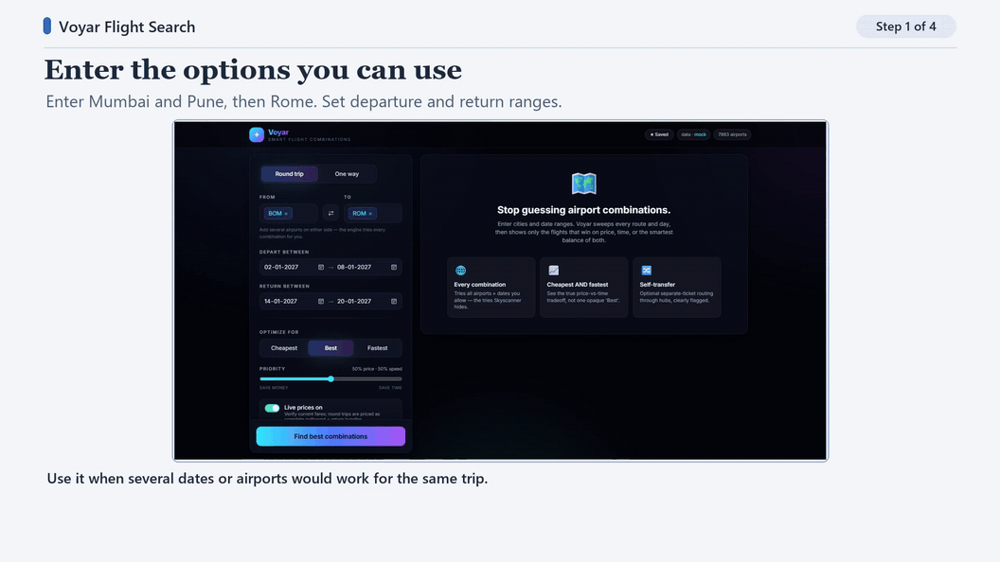

### Tools for testing and securing AI agents, plus backend and blockchain reference projects

Each repository runs with one command, has its tests in CI, and says in its README what was verified and what wasn't.

<!-- portfolio-demo-index -->
## Demo videos

See when to use each project and follow a short, captioned walkthrough. The project READMEs also include narrated videos.

- [Voyar Flight Search](#voyar-flight-search)
- [hometurf](https://github.com/trailofblocks/hometurf#watch-the-demo)
- [Online PostgreSQL Migration Kit](https://github.com/trailofblocks/postgres-migration-kit#watch-the-demo)
- [Dispute Evidence Desk](https://github.com/trailofblocks/dispute-evidence-desk#watch-the-demo)
- [Treasury Change Control](https://github.com/trailofblocks/treasury-change-control#watch-the-demo)
- [AI Release Gate](https://github.com/trailofblocks/ai-release-gate#watch-the-demo)
- [MCP Airlock](https://github.com/trailofblocks/mcp-airlock#watch-the-demo)
- [Reorg-Safe Blockchain Indexer](https://github.com/trailofblocks/reorg-safe-indexer#watch-the-demo)
- [Allowance](https://github.com/trailofblocks/allowance#watch-the-demo)
- [Scope Search](https://github.com/trailofblocks/permission-aware-search#watch-the-demo)
- [Proof-of-Exploit](https://github.com/trailofblocks/proof-of-exploit#watch-the-demo)
- [Payment Risk Feature Store](https://github.com/trailofblocks/payment-risk-feature-store#watch-the-demo)
- [Canary Release Lab](https://github.com/trailofblocks/canary-release-lab#watch-the-demo)
- [Payment Reconciliation Workbench](https://github.com/trailofblocks/payment-reconciliation-workbench#watch-the-demo)
- [Incident Replay Lab](https://github.com/trailofblocks/incident-replay-lab#watch-the-demo)
- [Strat Deck](https://github.com/trailofblocks/strat-deck-demo#watch-the-demo)
<!-- /portfolio-demo-index -->

## AI agents: testing and security

**[agent-crashtest](https://github.com/trailofblocks/agent-crashtest)** is chaos testing for an agent's tool calls. It injects lost replies, duplicate deliveries, crashes mid-step, garbled results, slow tools, and rate limits between an agent and its MCP tools. Then it checks a ledger of what really happened, rather than the agent's own account. In 117 single-fault runs, a typical framework retry policy repeated a side effect in 78. An agent that uses idempotency keys and an outbox repeated none.

**[mcp-airlock](https://github.com/trailofblocks/mcp-airlock)** is a runtime firewall for MCP servers. It does three things:

- pins every tool definition;
- strips hidden Unicode;
- blocks tool calls that carry content from an untrusted source, such as an issue or a web page, into a shell, a file write, or a network call.

A Claude Code hook applies the same checks to Claude Code's built-in tools. In its attack lab, all 7 prompt-injection attacks are stopped, and 2 of 10 benign workflows are held for approval.

**[proof-of-exploit](https://github.com/trailofblocks/proof-of-exploit)** is an AI auditor for Solidity that only reports bugs it can prove. Each finding comes with an exploit that an independent verifier has replayed on a fresh Anvil chain. Each patch is checked against that exploit and the project's existing tests. On its example protocol, the verifier proves the reference exploits for all 3 planted bugs and refuses to prove the decoy.

**[allowance](https://github.com/trailofblocks/allowance)** puts an AI agent's payment rules in an ERC-7579 smart-account module that the account owner sets, not the agent. It is an unaudited research project. It comes with a TypeScript SDK, an MCP server, x402 support, and a red-team lab of prompt-injection and stolen-key scenarios.

**[hometurf](https://github.com/trailofblocks/hometurf)** builds a private SWE-bench from a repository's own git history, and ranks coding-agent setups by solve rate with confidence intervals. On sqlparse, it mined 32 tasks. A reference agent that applies the real fix solves 32 of them, and an agent that changes nothing solves none.

These five are tested with scripted agents, which run without an API key. No benchmark results from real models are published yet.

## LLM applications

| Project | What it does |
|---|---|
| [incident-replay-lab](https://github.com/trailofblocks/incident-replay-lab) | Replays simulated incidents through logs, metrics, and traces. Its LLM-assisted diagnosis cites its evidence and abstains when signals compete. It passed 12 of 12 checks with a local Qwen 2.5 1.5B model. |
| [ai-release-gate](https://github.com/trailofblocks/ai-release-gate) | A CI gate for changes to an LLM agent. It runs the baseline and the candidate on the same labeled cases and fails the check on regressions. It blocks a candidate that broke 6 of 48 policy cases. |
| [permission-aware-search](https://github.com/trailofblocks/permission-aware-search) | Search with cited excerpts over internal documents that respects each reader's permissions. Revoked access disappears from results and citations without reindexing. |
| [strat-deck-demo](https://github.com/trailofblocks/strat-deck-demo) | Question answering over company filings that cites page numbers. It gave 20 of 20 correct answers and 10 of 10 correct abstentions with a local Qwen 2.5 1.5B model. |

## Backend and infrastructure

| Project | What it does |
|---|---|
| [postgres-migration-kit](https://github.com/trailofblocks/postgres-migration-kit) | Migrates a PostgreSQL schema while the table takes writes. The backfill is killed and resumed, a second API is canaried and rolled back, and every row is checked at the end. Written in Go. |
| [canary-release-lab](https://github.com/trailofblocks/canary-release-lab) | Canary releases on Kubernetes with Argo Rollouts and Prometheus. A healthy candidate is promoted, and one that returns HTTP 500s is aborted automatically. |
| [payment-reconciliation-workbench](https://github.com/trailofblocks/payment-reconciliation-workbench) | Event reconciliation with an idempotent double-entry ledger and worker lease recovery. Eight concurrent workers turn 500 deliveries into exactly 400 unique entries. |
| [payment-risk-feature-store](https://github.com/trailofblocks/payment-risk-feature-store) | Streams events through Kafka, serves features and scores from PostgreSQL, and exports point-in-time training rows. |
| [dispute-evidence-desk](https://github.com/trailofblocks/dispute-evidence-desk) | A case workflow that collects evidence with source references, requires a second reviewer, and exports a signed-off packet. |

## Blockchain

| Project | What it does |
|---|---|
| [reorg-safe-indexer](https://github.com/trailofblocks/reorg-safe-indexer) | An ERC-20 indexer that survives chain reorganizations. After a three-block reorg and an RPC outage, the API matched on-chain state for all 8 holders. |
| [treasury-change-control](https://github.com/trailofblocks/treasury-change-control) | A review desk for Safe multisig transfer proposals. It decodes the transaction, checks it against policy, binds approval to the exact Safe hash, and attaches a verified on-chain receipt. |

## How these repos are built

- **One command** runs each demo or lab. Most need no API key and no network.
- **Numbers come from tests or recorded runs.** The agent labs assert theirs in CI, so a README table can't drift from the code.
- **Limits are stated.** Each README says what was verified, on which platforms, and what wasn't.

**Stack:** TypeScript, Python, Go, Solidity, Node.js, FastAPI, React, PostgreSQL, Kafka, Kubernetes, Foundry, MCP

<!-- portfolio-demo-videos -->
## Voyar Flight Search

Voyar compares flights across flexible dates and airports, then shows which options save money or travel time. The walkthrough has on-screen captions.

[Download the narrated walkthrough](docs/demo/voyar/how-to.mp4?raw=true) · [Download the narrated overview](docs/demo/voyar/overview.mp4?raw=true)

<!-- /portfolio-demo-videos -->
